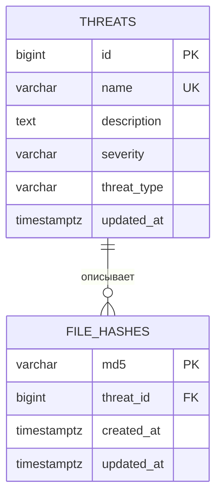

# Нормализованная схема базы данных

## Почему две таблицы

По одному названию угрозы могут существовать несколько файлов с разными MD5. Общие сведения не нужно дублировать в каждой строке файла, поэтому хеши и описание угрозы вынесены в связанные таблицы.

## `threats`

| Поле | Ограничения | Смысл |
| --- | --- | --- |
| `id` | `PRIMARY KEY` | внутренний идентификатор угрозы |
| `name` | `UNIQUE NOT NULL`, не более 255 символов | название угрозы |
| `description` | `NOT NULL`, по умолчанию `''` | общее описание |
| `severity` | `CHECK`, значение по умолчанию `unknown` | общая степень опасности |
| `threat_type` | `CHECK`, значение по умолчанию `other` | тип угрозы |
| `updated_at` | `NOT NULL` | время последнего изменения общих сведений |

Допустимые `severity`: `unknown`, `low`, `medium`, `high`, `critical`. Допустимые `threat_type`: `other`, `trojan`, `worm`, `ransomware`, `spyware`.

## `file_hashes`

| Поле | Ограничения | Смысл |
| --- | --- | --- |
| `md5` | `PRIMARY KEY`, 32 строчных шестнадцатеричных символа | хеш файла |
| `threat_id` | `NOT NULL`, внешний ключ `threats(id)` | связанная угроза |
| `created_at` | `NOT NULL` | время регистрации MD5 |
| `updated_at` | `NOT NULL` | время последнего изменения привязки MD5 |

Для `threat_id` есть индекс `file_hashes_threat_id_idx`. Ссылочная целостность защищена внешним ключом с `ON DELETE RESTRICT`.

## Связь и правила

- отношение: одна запись `threats` к нескольким строкам `file_hashes` (1:N)
- уникальность MD5 обеспечивается первичным ключом, имя угрозы уникально в справочнике
- GET делает JOIN таблиц и отдаёт объединённый JSON без внутреннего `threat_id`
- POST либо создаёт новую угрозу, либо привязывает MD5 к существующему названию, если метаданные не противоречат сохранённым
- PUT меняет привязку одного MD5, но обновление общих метаданных затрагивает всю связанную угрозу
- `created_at` в HTTP-ответе — дата регистрации MD5, `updated_at` — более поздняя из дат изменения хеша и общего описания

Полный исполняемый SQL находится в [`../migrations/000001_init.up.sql`](../migrations/000001_init.up.sql). Этот документ описывает схему, но не заменяет миграции.
