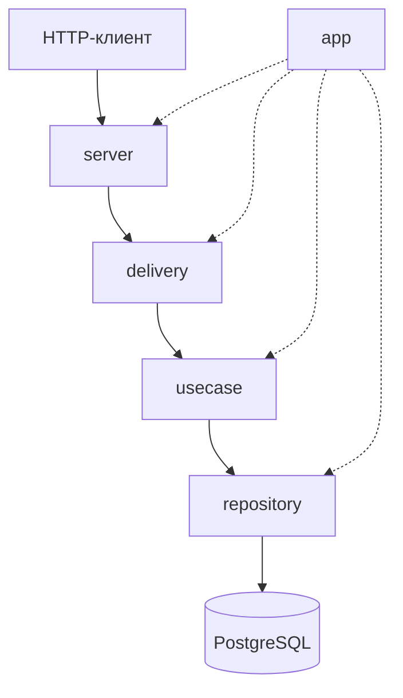

# Архитектура сервиса

## Назначение

Сервис предоставляет три REST-операции для добавления, поиска и обновления сведений об угрозе по MD5. Проверка самого файла в задачи сервиса не входит.

## Структура и ответственность

| Путь | Ответственность |
| --- | --- |
| `cmd/server` | запуск HTTP-сервера и корректное завершение |
| `internal/app` | композиция зависимостей слоёв |
| `internal/server` | маршруты HTTP, не зависит от пакета delivery |
| `internal/delivery/threat` | HTTP-обработчики, разбор JSON, преобразование ошибок в статусы |
| `internal/delivery/threat/dto` | структуры входных JSON-запросов |
| `internal/usecase/threat/threat.go` | сценарии получения, создания и обновления угрозы |
| `internal/usecase/threat/validation.go` | проверка и нормализация полей угрозы |
| `internal/repository/threat` | транзакции и SQL запросы к PostgreSQL |
| `internal/models` | модели предметной области |
| `internal/apperrors` | общие типизированные ошибки |
| `internal/httputil` | формирование JSON-ответов |
| `internal/config` | настройки приложения из окружения |

## Зависимости

Стрелки сплошной линией обозначают поток вызовов. В коде `server` не импортирует `delivery`: ему передаются обработчики через `server.Config`. Пакет `usecase` также не импортирует реализацию `repository`, работая через небольшой интерфейс. Только `app` знает о конкретных реализациях и собирает их.

В каждом слое собственная структура `Config` с необходимыми зависимостями. Пакеты `models` и `apperrors` доступны нескольким слоям: это общие типы, а не зависимости от реализации другого слоя.

## Поток запроса

1. `server` направляет запрос в нужный обработчик `delivery`
2. `delivery` читает JSON в DTO, проверяет формат тела и вызывает интерфейс usecase
3. `usecase` проверяет MD5, имя и дополнительные поля, нормализует значения
4. `repository` выполняет SQL-запросы и транзакции
5. `delivery` возвращает JSON и HTTP-статус через `httputil`

## Валидация

- `delivery`: `Content-Type: application/json`, корректность и единственность JSON-объекта, неизвестные поля, запрет `null`, предел 64 KiB
- `usecase`: MD5 из 32 шестнадцатеричных символов, непустое имя не более 255 символов, описание до 2048 символов, разрешённые значения `severity` и `threat_type`
- `repository` / БД: уникальность MD5 и имени угрозы, внешние ключи, ограничения CHECK

## Ошибки

Usecase и repository возвращают ошибки из `apperrors` с возможным дополнительным контекстом. В `delivery` ошибки сопоставляются с кодами 400, 404, 409 и 500. Внутренние ошибки БД не раскрываются клиенту.

## Обновление информации

Одна запись `threats` может относиться к нескольким MD5. Изменение общих полей угрозы (`description`, `severity`, `threat_type`) через PUT отражается для всех связанных MD5. Изменение `name` перепривязывает конкретный MD5 к другой записи угрозы, не переименовывая запись для остальных хешей.

Непереданные общие поля при PUT сохраняют значения. При POST противоречащие метаданные существующего названия приводят к 409.
